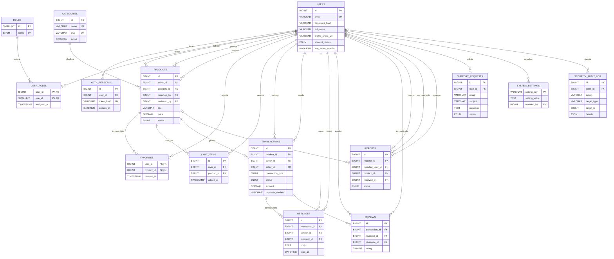

# Modelo Entidad-Relación y normalización

Base de datos: `basededatosupeckmarquetspringboot` (MariaDB / InnoDB).

## Diagrama Entidad-Relación

`o|` representa una relación opcional (FK nullable). En `products`, los roles de vendedor, reservante y moderador corresponden a tres FK distintas hacia `users`.

## Relaciones principales

- **Usuarios y roles:** N:M, resuelta con `user_roles`. El registro asigna `BUYER` y `SELLER`; permisos administrativos se asignan explícitamente.
- **Usuarios y productos:** 1:N como vendedor. Cada publicación pertenece a una categoría y guarda por separado quién la reservó y quién la moderó.
- **Favoritos:** N:M entre usuarios y productos, con clave primaria compuesta `(user_id, product_id)`.
- **Carrito:** un usuario puede agregar varios productos; la clave única `(user_id, product_id)` evita duplicados. Agregar no reserva el artículo.
- **Transacciones:** cada transacción corresponde a un producto, comprador y vendedor; un usuario puede participar en varias como comprador o vendedor.
- **Mensajes:** cada mensaje tiene remitente y destinatario; opcionalmente se vincula a una transacción.
- **Reseñas:** cada reseña pertenece a una transacción y tiene revisor y evaluado. La restricción única `(transaction_id, reviewer_id)` limita a una reseña por participante y transacción.
- **Reportes:** pueden señalar un usuario, un producto o ambos; el administrador que resuelve el reporte es opcional.

## Normalización aplicada

### Primera Forma Normal (1FN)

- Cada tabla tiene una clave primaria y columnas con valores individuales; no se guardan listas de roles, categorías, artículos del carrito o mensajes en una sola columna.
- Las relaciones repetibles se representan con filas (`user_roles`, `cart_items`, `favorites`, `messages`).
- `security_audit_log.details` es la excepción deliberada: un objeto JSON para metadatos variables de auditoría. No se usa para atributos centrales que requieran joins, filtros relacionales o claves foráneas.

### Segunda Forma Normal (2FN)

- Las tablas con clave compuesta (`user_roles` y `favorites`) guardan datos que dependen de la combinación completa de sus claves.
- En `user_roles`, `assigned_at` corresponde a la asignación específica usuario-rol; en `favorites`, `created_at` corresponde al favorito usuario-producto.
- `cart_items` usa una clave sustituta, y además una restricción única sobre usuario-producto para representar la dependencia funcional de ese par.

### Tercera Forma Normal (3FN)

- Los datos descriptivos de roles y categorías están separados de usuarios y productos. Por ejemplo, el nombre de la categoría se guarda en `categories`, y `products` almacena `category_id`.
- Los atributos propios del usuario, producto, transacción y reporte se mantienen en sus respectivas tablas; no se replican nombres de roles o categorías en cada publicación.
- Las tablas de unión evitan repetir grupos de atributos para relaciones N:M.
- Los estados y tipos con conjunto controlado se restringen con `ENUM`; las categorías y roles, que además tienen identidad y atributos, usan tablas maestras independientes.

## Decisión de historial transaccional

`transactions.seller_id` y `transactions.amount` guardan una copia del vendedor y del precio al concretarse la operación. Aunque el vendedor puede derivarse de `products.seller_id` y el monto del precio actual, conservarlos en la transacción es intencional: mantiene el historial contable si luego cambia el precio o se modifica la publicación. Por esa misma razón, la aplicación debe tomar ambos valores desde el producto reservado al crear la transacción, no confiar en valores suministrados por el cliente.

## Consideraciones

- El índice público de confianza se calcula desde `reviews`; no se almacena como dato duplicado.
- La reserva se representa en `products` (`status`, `reserved_by`, `reservation_expires_at`) para que varios compradores no obtengan reservas simultáneas del mismo producto.
- Los índices y restricciones únicos refuerzan búsquedas frecuentes e integridad referencial; las FK usan InnoDB.
